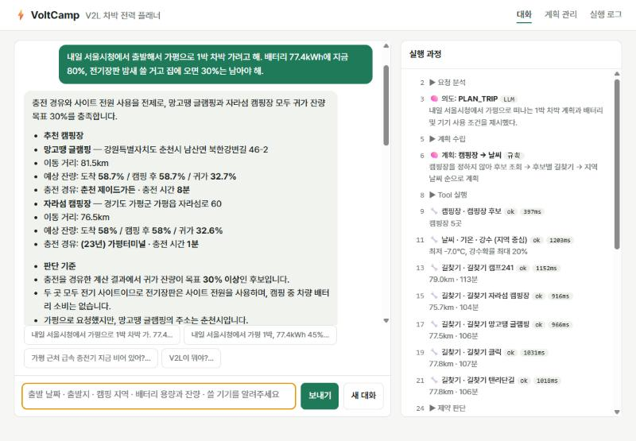
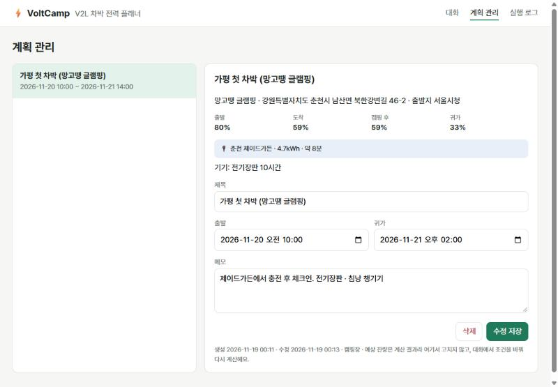
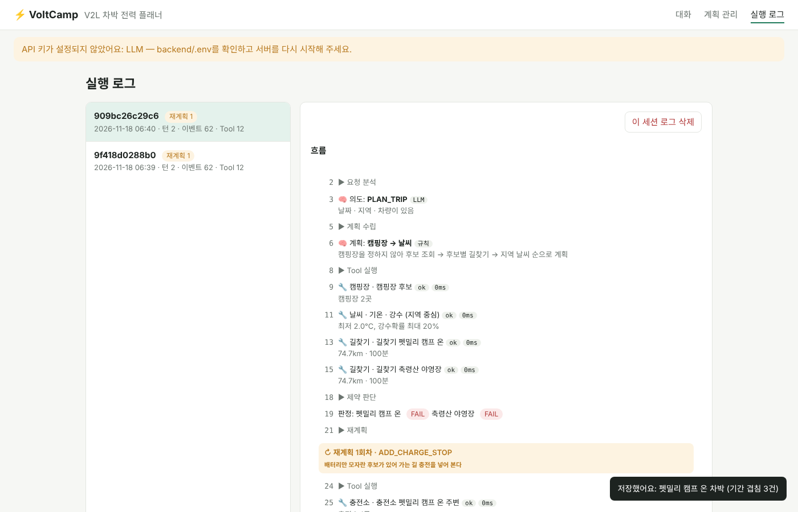

# VoltCamp ⚡🏕️

> 전기차 배터리를 캠핑장 전원으로 쓰는 차박 계획을, 실제 데이터로 검증해 주는 AI Agent 플래너

"이 배터리로 거기까지 가서 밤새 전기장판 켜고 돌아올 수 있을까?"
VoltCamp는 이 질문을 캠핑장 · 충전소 · 날씨 · 경로 데이터로 계산하고, 부족하면 충전 경유지나 다른 캠핑장을 찾아 차박 계획을 다시 짭니다.

## 왜 만들었나 — 작은 마이크로그리드

V2L(Vehicle-to-Load)을 지원하는 전기차는 캠핑장에서 하나의 작은 마이크로그리드가 됩니다.

| 마이크로그리드 구성 | VoltCamp에서 |
|---|---|
| ESS (에너지 저장장치) | 전기차 배터리 |
| 섬(Island) 모드 공급 | 캠핑장에서 V2L로 가전 사용 |
| 계통 연결 | 이동 경로상의 급속 충전소 · 전기 사이트 캠핑장 |
| EMS (에너지 관리) | Agent가 수요 · 공급 · 환경을 비교해 계획 |



| 계획 관리 | 실행 로그 (재계획 · Tool 실패 처리) |
|---|---|
|  |  |

## 주요 기능

- **차박 계획 수립**: 출발지 · 날짜 · 차량(배터리 용량 · 잔량) · 사용할 기기를 말하면 캠핑장 후보별로 도착 / 캠핑 후 / 귀가 시 예상 잔량을 계산
- **4가지 제약 판단**
  - 에너지: 왕복 주행 + 캠핑 소비 후에도 V2L 방전 제한 · 귀가 최소 잔량을 지키는지
  - 출력: 동시에 쓰는 기기 전력이 V2L 최대 출력 이내인지
  - 강수: 비 예보 시 실외 V2L 사용이 불가능한지
  - 일정: 차박 기간에 캘린더의 다른 일정과 겹치는지 (겹치면 재계획 대신 날짜 변경 제안)
- **재계획**: 조건을 못 맞추면 충전 경유 추가 → 전기 사이트 캠핑장으로 교체 → 탐색 반경 확대 (상한 있음)
- **대화 맥락 유지**: "같은 날 홍천 쪽으로"처럼 바뀐 조건만 반영
- **계획 관리**: 차박 계획 저장 · 조회 · 수정 · 삭제, 기간이 겹치는 계획 알림
- **실행 로그**: 메인 Agent의 단계 · Tool 호출 · 판단을 이벤트로 발행하고, 별도 로깅 Agent가 세션 단위로 기록
- **이상 징후 판단**: 로깅 Agent가 턴마다 규칙으로 반복 호출 · 재계획 과다 · 계획에 없던 Tool · 결과 누락을 판정하고,
  경고가 난 턴만 LLM이 원인을 진단 (판정과 진단은 따로 저장). 메인 Agent는 다음 턴 응답에 직전 경고를 싣는다
- **캘린더 연동**: 저장한 계획을 대화("캘린더에 등록해줘")나 계획 관리 화면에서 등록. 등록 Tool은 계획 번호만 받고
  제목 · 시각은 저장소에서 읽는다. 로컬 저장소 구현체가 기본이고 `CALENDAR_PROVIDER=google`로 Google Calendar에 연동

## 아키텍처

```
[Frontend]  대화 · 계획 관리 · 실행 로그 화면
     │ REST
[Backend: FastAPI]
     ├─ Main Agent (LangGraph)  analyze → plan → execute → judge ⇄ replan → respond
     │      ├─ 외부 API Tools: search_campsites · get_route · get_weather · search_chargers
     │      └─ 로컬 Tools: list_schedule · register_plan_to_calendar ──▶ Calendar (local | Google)
     ├─ EventBus ──▶ Logging Agent ──▶ run_events
     │                  └─ 이상 징후 판정(규칙) ──▶ anomalies ──(WARN만)──▶ 원인 진단(LLM)
     └─ SQLite: plans · run_events · anomalies · calendar_events
```

## 기술 스택

Python 3.10+ · LangGraph · LangChain · FastAPI · SQLite · HTML/CSS/JavaScript(ES 모듈)

## 외부 데이터 출처

| 데이터 | 출처 | 이용 조건 |
|---|---|---|
| 캠핑장 정보 | 한국관광공사 고캠핑 정보 조회서비스 (공공데이터포털) | 공공데이터포털 이용약관 · 개발계정 트래픽 |
| 전기차 충전소 위치 · 상태 | 한국환경공단 전기자동차 충전소 정보 (공공데이터포털) | 공공데이터포털 이용약관 · 개발계정 트래픽 |
| 기온 · 강수 예보 | 기상청 단기예보 조회서비스 (공공데이터포털) | 공공데이터포털 이용약관 · 개발계정 트래픽 |
| 주소 검색 · 자동차 길찾기 | 카카오 로컬 API · 카카오모빌리티 길찾기 API | 각 서비스 무료 쿼터 |

## 시작하기

### 백엔드

```bash
cd backend
python -m venv .venv
# Windows: .venv\Scripts\activate   /   macOS·Linux: source .venv/bin/activate
pip install -r requirements-dev.txt

cp .env.example .env              # 키 입력 (Windows: copy .env.example .env)
python scripts/check_apis.py      # 외부 API · LLM 연결 확인
python -m pytest -q               # 테스트 (네트워크 없이 실제 응답 샘플로)
uvicorn app.main:app --reload     # http://127.0.0.1:8000/docs
```

### 프론트엔드

빌드 없이 정적 파일로 동작한다. 백엔드를 켠 상태에서:

```bash
cd frontend
python serve.py                   # http://127.0.0.1:5173
python serve.py 5173 http://127.0.0.1:8000   # 포트 · 백엔드 주소 지정
```

`serve.py`는 정적 파일을 캐시 없이 내주고 `/api/*` 요청을 백엔드로 넘긴다. 브라우저 입장에서는 같은 출처라
CORS 설정 없이 동작한다. 백엔드를 다른 주소로 직접 부르려면 `index.html`에서 `window.VOLTCAMP_API`를 지정한다.

### 필요한 키

| 환경변수 | 발급처 |
|---|---|
| `DATA_GO_KR_SERVICE_KEY` | 공공데이터포털 — 고캠핑 · 전기자동차 충전소 정보 · 기상청 단기예보 활용신청 후 일반 인증키(Decoding) |
| `KAKAO_REST_API_KEY` | 카카오 디벨로퍼스 — 앱 생성 → 카카오맵 활성화 → REST API 키 |
| `OPENAI_API_KEY`, `LLM_MODEL` | OpenAI (또는 호환 엔드포인트 + `OPENAI_BASE_URL`). Tool 호출은 Responses API를 사용 |
| `CALENDAR_PROVIDER` (선택) | `local`(기본, 서버 DB) 또는 `google` |
| `GOOGLE_CLIENT_SECRET_FILE` · `GOOGLE_TOKEN_FILE` (선택) | Google Cloud 콘솔 → Calendar API 사용 → OAuth 클라이언트(데스크톱 앱) JSON. `python scripts/google_calendar_auth.py`로 토큰 발급 |

## 진행 상황

- [x] 외부 API 연결 확인 스크립트
- [x] Tool 4종 + 공통 응답 · 실패 코드
- [x] 배터리 제약 계산 (에너지 · 출력 · 강수)
- [x] Agent 실행 흐름 · 재계획 · 대화 맥락
- [x] 이벤트 발행 · 로깅 Agent
- [x] 차박 계획 저장 · 기간 겹침
- [x] FastAPI 백엔드
- [x] 프론트엔드 (대화 · 계획 관리 · 실행 로그)
- [x] 심화: 실행 로그 이상 징후 판단 (F3020)
- [x] 심화: 캘린더 연동 (F3023)

## 안내

잔량 · 소비량은 입력값과 예보로 계산한 추정치입니다. 실제 사용 시에는 차량 표시값을 확인하고, V2L 사용 한도와 안전 수칙은 차량 사용설명서를 따르세요.
